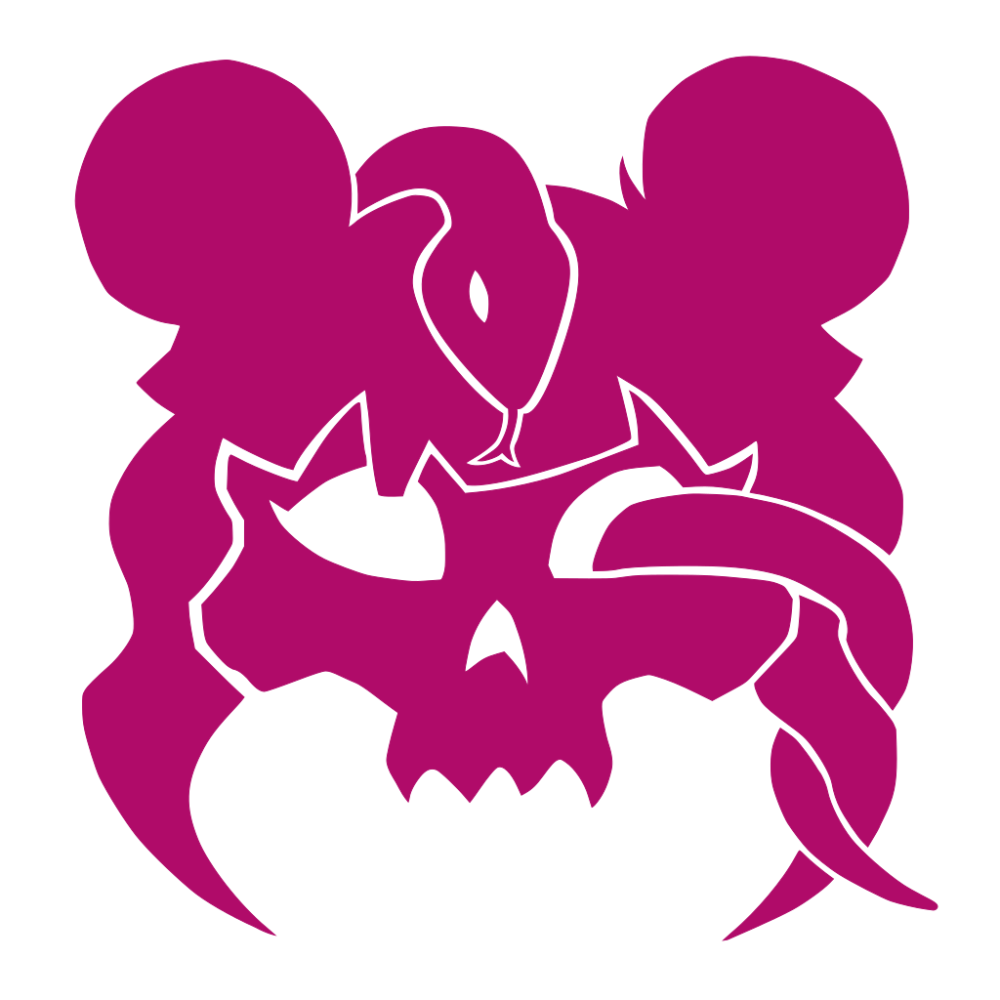
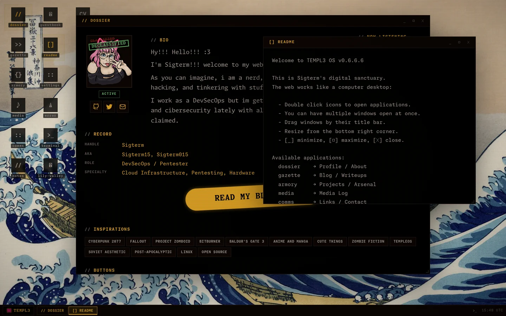
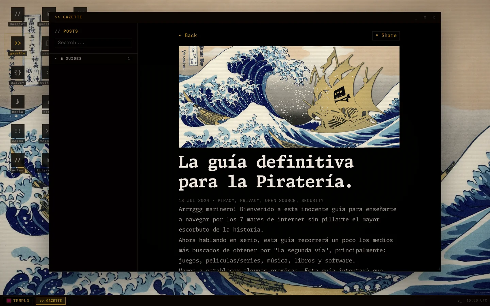
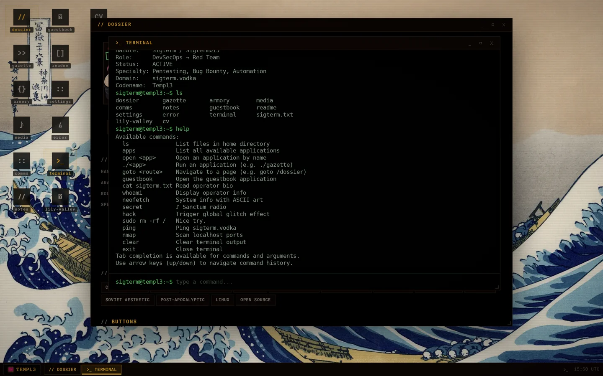
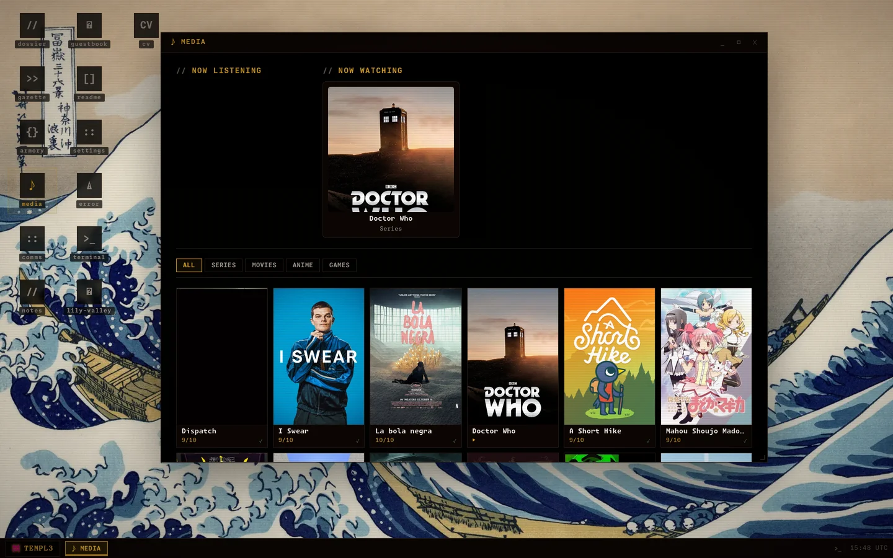
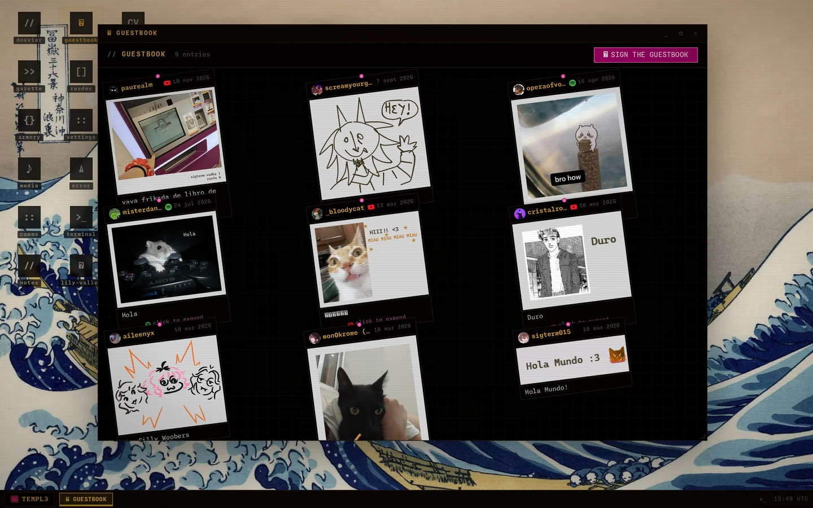
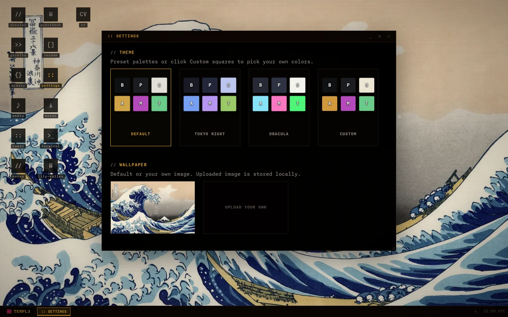
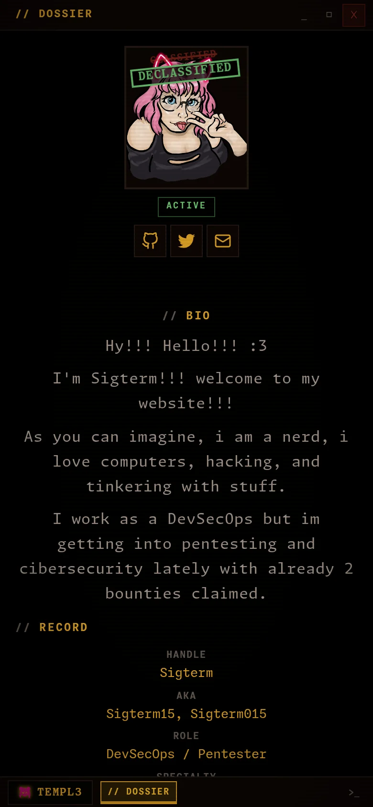
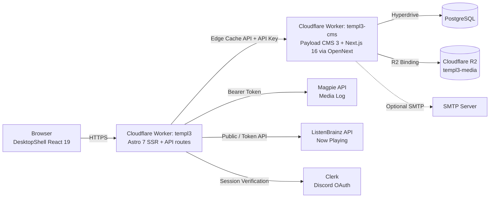

<div align="center">
  
  <h1>Templ3</h1>
  <p>A personal site modeled as a retro desktop operating system (<strong>Templ3 OS</strong>) in the browser, powered by Astro, React, and Payload CMS on Cloudflare Workers.</p>
  <p>
    <a href="https://sigterm.vodka"><strong>Live at sigterm.vodka</strong></a>
    &nbsp;&middot;&nbsp;
    <a href="#features">Features</a>
    &nbsp;&middot;&nbsp;
    <a href="#architecture">Architecture</a>
    &nbsp;&middot;&nbsp;
    <a href="#getting-started">Getting Started</a>
  </p>
  <p>
    <a href="https://github.com/SIGTERM-015/templ3/actions/workflows/deploy-site.yml"></a>
    <a href="https://github.com/SIGTERM-015/templ3/actions/workflows/deploy-cms.yml"></a>
  </p>
  <p>
    
    
    
    
    
    
  </p>
</div>

<p align="center">
  
</p>

## Features

- **Desktop window manager** — Every page renders inside a single React shell (`DesktopShell`) with draggable, resizable, minimizable, and maximizable windows, draggable desktop icons, a taskbar with an app menu and UTC clock, and a CSS CRT scanline/vignette overlay. Window state persists in `sessionStorage` and stays synchronized with browser routes.
- **Dossier (`/`)** — Operator profile with bio, record metadata, inspirations, an 88×31 web button collection (with a copyable embed modal), and a live **ListenBrainz** now-playing indicator.
- **Gazette (`/blog`)** — Blog and writeup reader with category folders, search, and Payload Lexical rich text supporting syntax-highlighted code blocks, callouts, bookmarks, and YouTube/Spotify/Gist/CodePen embeds.
- **Armory (`/arsenal`)** — Project portfolio with CMS-managed statuses, tech stack tags, and repository/live links.
- **Media (`/media`)** — Personal media log powered by a **Magpie** (Yamtrack fork) instance with type filters, ratings, currently watching cards, and per-title detail views.
- **Guestbook (`/guestbook`)** — Polaroid-style board of community drawings and optional Spotify/YouTube embeds. Visitors sign in with Discord via **Clerk**, draw on a lazy-loaded **Excalidraw** canvas, and submit entries (rate-limited at the Worker edge and moderated in the CMS).
- **Notes (`/notes`) & Comms (`/links`)** — File-explorer view for sanitized Markdown notes (`marked` + `DOMPurify`) that open in individual viewer windows, plus grouped contact/social links.
- **Interactive Terminal (<kbd>Ctrl</kbd>+<kbd>`</kbd>)** — Shell with tab completion, command history, app launchers (`open`, `./<app>`, `goto`), `whoami`, `neofetch`, `ls`, `cat sigterm.txt`, `ping`, `nmap`, and easter eggs (`hack`, `secret`, `sudo rm -rf /`).
- **Live theming & dynamic WebApps** — Runtime CSS variable presets (`Default`, `Tokyo Night`, `Dracula`), a 6-color custom theme builder, local wallpaper upload persisted in `localStorage`, and CMS-defined iframe WebApps (`webapp-<slug>`).
- **Edge media & OG images** — Dynamic 1200×630 Open Graph PNGs generated at `/api/og/*` with `workers-og` (patched via `patches/workers-og@0.0.27.patch`) and responsive image proxying via Cloudflare Image Transformations at `/api/img/[...path]`.

<div align="center">
  <table>
    <tr>
      <td align="center" width="50%">
        <br />
        <sub><strong>Gazette</strong> — Blog and writeups with category folders and rich text</sub>
      </td>
      <td align="center" width="50%">
        <br />
        <sub><strong>Terminal</strong> — Built-in shell with tab completion and app launchers</sub>
      </td>
    </tr>
    <tr>
      <td align="center" width="50%">
        <br />
        <sub><strong>Media</strong> — Magpie-backed media log, ratings, and now-watching cards</sub>
      </td>
      <td align="center" width="50%">
        <br />
        <sub><strong>Guestbook</strong> — Polaroid board of Discord-authenticated Excalidraw sketches</sub>
      </td>
    </tr>
  </table>
  <p>
    
    &nbsp;
    
    <br />
    <sub><strong>Settings</strong> (live theme presets, custom colors, local wallpaper) and responsive <strong>mobile layout</strong> (390×844)</sub>
  </p>
</div>

## Architecture



Each Astro route (`export const prerender = false`) fetches initial content on the Cloudflare Worker and serializes it as a `serverData` JSON prop into `Layout.astro`, which mounts the single `DesktopShell` React tree. Subsequent client-side window opens fetch from `/api/*.json` Worker routes. Because Cloudflare does not cache subrequests carrying an `Authorization` header, authenticated reads to Payload CMS and Magpie pass through `cachedJson()` (`apps/site/src/lib/edgeCache.ts`), which stores parsed JSON in the Workers Cache API under credential-free keys with tiered TTLs (5 min to 24 h) and serves uncached `503` responses on upstream failure.

## Tech Stack

| Layer | Technology |
| --- | --- |
| Frontend framework | Astro 7 (`@astrojs/cloudflare`), React 19, TypeScript 5.7 |
| Guestbook auth & canvas | Clerk (`@clerk/astro`, Discord OAuth), Excalidraw (lazy-loaded) |
| Rich text & markdown | `@payloadcms/richtext-lexical`, `marked`, `DOMPurify` |
| Dynamic OG & images | `workers-og` (Satori + resvg WASM), Cloudflare Image Transformations |
| Headless CMS | Payload CMS 3, Next.js 16, `payload-totp` (2FA), Nodemailer |
| Database & storage | PostgreSQL (via Cloudflare Hyperdrive in production), Cloudflare R2 |
| Hosting & runtime | Cloudflare Workers (`wrangler`, `@opennextjs/cloudflare`) |
| External integrations | Magpie (media log), ListenBrainz (now playing), AniList / IGDB / TMDB / Open Library / MusicBrainz (CMS media lookup) |
| Testing & linting | Vitest 4, Playwright, ESLint 9, Prettier (`apps/cms`); TypeScript strict check (`apps/site`) |

## Repository Layout

```text
templ3/
├── apps/
│   ├── site/              # Astro 7 + React 19 desktop OS frontend (Cloudflare Worker: sigterm.vodka)
│   └── cms/               # Payload CMS 3 + Next.js 16 backend (Cloudflare Worker: cms.sigterm.vodka)
├── packages/              # Reserved workspace directory for shared packages (currently empty)
├── patches/               # pnpm dependency patches (workers-og WASM init guard)
└── .github/workflows/     # CI/CD workflows for site previews/deploys and CMS tests/migrations/deploys
```

## Getting Started

### Prerequisites

- **Node.js `>=22.12.0`** (CI runs Node 22)
- **pnpm `10.30.3`** (managed via `packageManager` — enable with `corepack enable`)
- **PostgreSQL** (required for running `apps/cms` locally)

### Installation

```bash
corepack enable
pnpm install
```

### Environment Variables

Do not commit `.env` or `.dev.vars` files.

- **`apps/site`** — copy [`apps/site/.env.example`](apps/site/.env.example) to `apps/site/.env` (or `.dev.vars` for Wrangler) and configure:
  - `PUBLIC_CMS_URL` — CMS base URL (e.g. `http://localhost:3000` locally)
  - `PAYLOAD_API_KEY` — Payload API key for authenticated CMS requests and guestbook writes
  - `PUBLIC_CLERK_PUBLISHABLE_KEY`, `CLERK_SECRET_KEY` — Clerk keys for guestbook Discord auth
  - `MAGPIE_API_URL`, `MAGPIE_API_TOKEN` — Magpie instance URL and read-only bearer token
  - `LISTENBRAINZ_USERNAME`, `LISTENBRAINZ_TOKEN` *(optional)* — ListenBrainz username and optional token for cover art lookup
- **`apps/cms`** — create `apps/cms/.env` with:
  - `DATABASE_URL` — Local PostgreSQL connection string (`DATABASE_URL_PROD` is used by `migrate:prod`)
  - `PAYLOAD_SECRET` — Required secret used by Payload CMS
  - `NEXT_PUBLIC_SERVER_URL` — Public base URL of the CMS
  - `SMTP_HOST`, `SMTP_PORT`, `SMTP_USER`, `SMTP_PASS`, `SMTP_FROM` *(optional)* — SMTP transport settings
  - `TWITCH_CLIENT_ID`, `TWITCH_CLIENT_SECRET`, `TMDB_API_KEY` *(optional)* — Providers for the CMS `/media-lookup` endpoint
  - `PAYLOAD_LOG_LEVEL` *(optional)* — Production logger level

### Running Locally

```bash
pnpm dev
```

This starts both apps in parallel:

- **Site (`apps/site`)**: `http://localhost:4321`
- **CMS (`apps/cms`)**: `http://localhost:3000` (admin panel at `/admin`)

## Scripts

All scripts are run from the repository root:

| Script | Description |
| --- | --- |
| `pnpm dev` | Run `apps/site` and `apps/cms` dev servers in parallel |
| `pnpm dev:site` | Start only the Astro dev server (`apps/site`) |
| `pnpm dev:cms` | Start only the Next.js / Payload dev server (`apps/cms`) |
| `pnpm build:site` | Build `apps/site` for Cloudflare Workers |
| `pnpm build:cms` | Build the Next.js / Payload CMS application |
| `pnpm deploy:site` | Deploy `apps/site` via Wrangler |
| `pnpm deploy:cms` | Build and deploy `apps/cms` via OpenNext and Wrangler |
| `pnpm preview:cms` | Build the OpenNext bundle and upload a preview version for `apps/cms` |
| `pnpm generate:cms-types` | Regenerate `apps/cms/src/payload-types.ts` after schema changes |
| `pnpm cf:build:site` | Build `apps/site` for Cloudflare Workers |
| `pnpm cf:upload:site` | Upload a Cloudflare Workers preview version for `apps/site` |
| `pnpm cf:build:cms` | Build Next.js and package the OpenNext Cloudflare bundle for `apps/cms` |
| `pnpm cf:deploy:cms` | Deploy the built `apps/cms` bundle via Wrangler |
| `pnpm cf:upload:cms` | Upload a Cloudflare Workers preview version for `apps/cms` |

## Deployment

Both apps deploy to Cloudflare Workers via GitHub Actions. Required repository secrets, variables and CI caveats are documented in [`docs/ci.md`](docs/ci.md).

- **Deploy Site (`.github/workflows/deploy-site.yml`)** — Runs on pushes to **any branch** modifying `apps/site/**`, `package.json`, `pnpm-lock.yaml`, or `patches/**` (plus manual dispatch). Runs `typecheck`, `pnpm build:site`, and `check:client-bundle` (ensuring no server-only code leaks into the browser bundle). Pushes to `main` deploy to production (`sigterm.vodka`); non-`main` branches upload a Wrangler preview version and post or update the preview URL on any open PR.
- **Deploy CMS (`.github/workflows/deploy-cms.yml`)** — Runs on pushes to **`main`** modifying `apps/cms/**`, `package.json`, `pnpm-lock.yaml`, or `patches/**` (plus manual dispatch). A `test` job spins up PostgreSQL 17 and runs `tsc --noEmit`, ESLint, `check:migrations`, and Vitest integration tests. Once green, the `deploy` job runs Payload database migrations against `DATABASE_URL_PROD`, builds the OpenNext Cloudflare bundle (`pnpm cf:build:cms`), and deploys to `cms.sigterm.vodka`.

## Contributing & Development Notes

See [`AGENTS.md`](AGENTS.md) (along with [`apps/site/AGENTS.md`](apps/site/AGENTS.md) and [`apps/cms/AGENTS.md`](apps/cms/AGENTS.md)) for workspace conventions, coding style, type generation, and validation commands.
